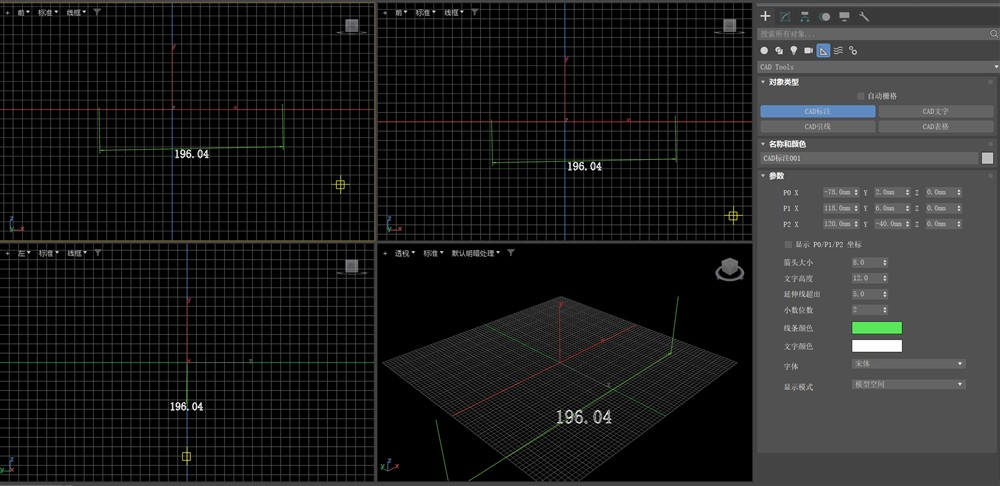
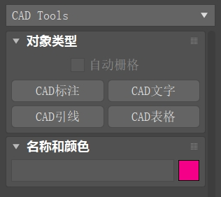
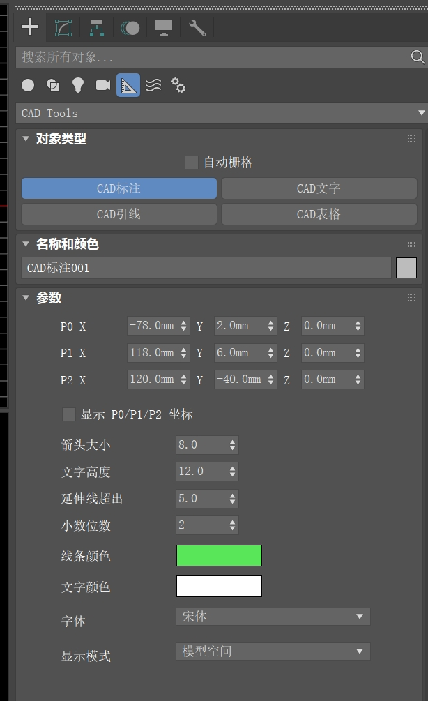
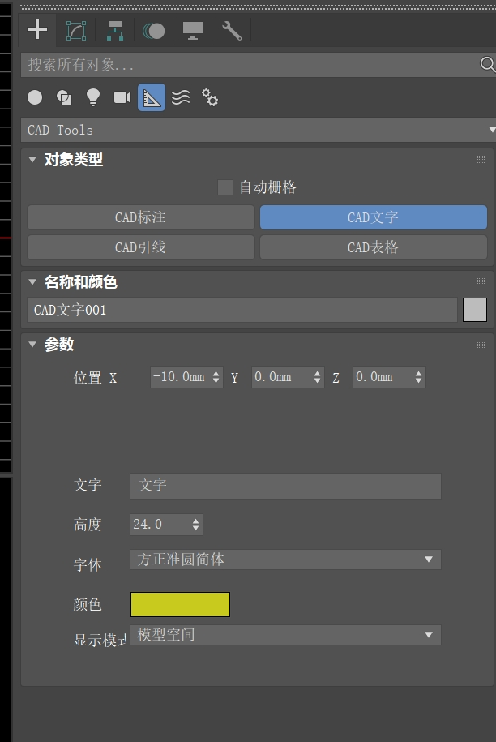
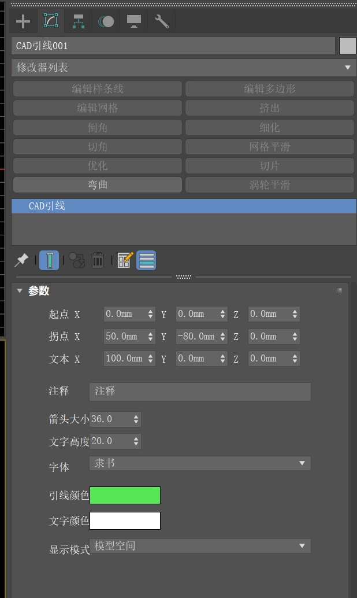
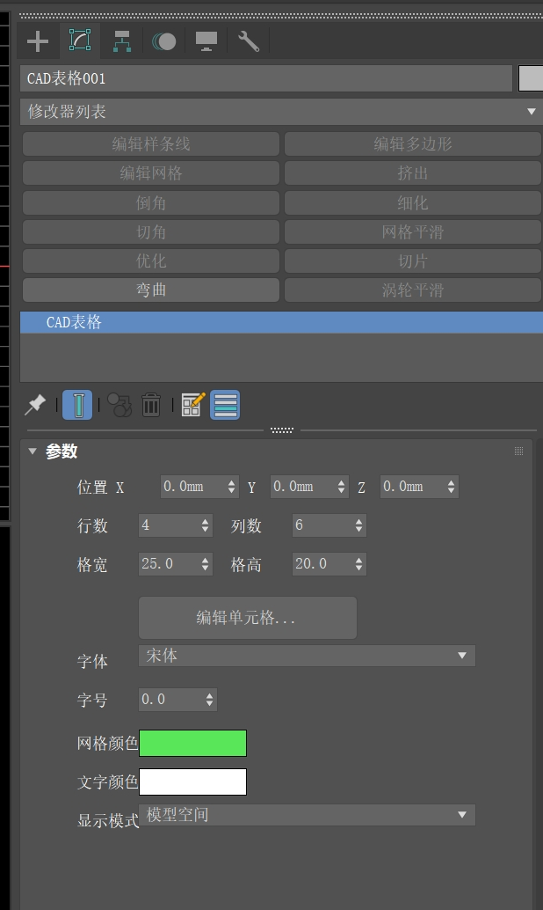

# CAD 注释工具集（CADBundle）

3ds Max 2027 插件：编译为单个 Plugin Bundle（`CADBundle.dlo`），在创建面板的 **CAD Tools** 分类下注册 4 个对象类。

## 功能

- **统一入口**：创建面板 → **CAD Tools** → 选择 CADDimension / CADText / CADLeader / CADTable；参数在修改面板调整。
- **显示模式（sizeMode）**：四类均支持 `模型空间`（新建默认，1）与 `屏幕恒定`（0）；模型模式下文字随场景缩放，箭头/延伸线仍按屏幕像素；表格为整表世界单位。
- **CADDimension**：三点线性标注（起点、终点、尺寸线参考点）；延伸线、闭合三角箭头、精度 0–6、可选坐标标签、字体、文字高度、RGB 颜色。
- **CADText**：单击放置文字；BezFont 真实字形与字号；默认字体宋体；字体缺失时回退默认/CJK 字体；billboard 面向视图。
- **CADLeader**：三点引线（起点、拐点、文本位置）；折线、闭合三角箭头、注释文本、字体与文字高度。
- **CADTable**：单击插入表格；行列 1–50、单元格宽高、字体/字号、RGB 颜色；修改面板内"编辑单元格…"提供网格编辑器（行列迁移按交集保留）；可见格过多或字形过小时自动回落到 GDI 文本绘制（带滞回，切换写入 3ds Max 日志）。

4 个对象类 `IsPublic() = TRUE`：创建面板与 MAXScript 构造函数（如 `CADDimension()`）均可创建；Utility 面板已按 U11 移除。

## 环境要求

- 3ds Max 2027 x64
- Visual Studio 2022 或更新版本（v143 工具集）、C++20、Windows SDK 10.0.19041.0
- 3ds Max 2027 SDK（默认 `D:\3dsMaxSDK2027\maxsdk`）
- 不需要 Qt 开发包（参数 UI 使用 Win32 `P_AUTO_UI`）

## 构建

见 [BUILD.md](BUILD.md)。产物：`build\x64\Release\plugins\CADBundle.dlo`。

## 安装

1. 关闭 3ds Max。
2. 若 `<3ds Max 2027>\plugins` 中存在旧 `CADDimension.dlo`，先备份并记录 SHA-256（步骤见 [docs/release/acceptance-checklist.md](docs/release/acceptance-checklist.md)）。
3. 复制 `CADBundle.dlo` 到 `<3ds Max 2027>\plugins`。
4. 启动 3ds Max → 创建面板 → **CAD Tools** → 选择对应工具。

卸载：删除 `CADBundle.dlo`；如曾备份旧插件，按备份恢复。

## 使用

| 工具 | 交互 | 参数入口 |
|---|---|---|
| 标注 | 依次点击起点、终点、尺寸线位置 | 修改面板 |
| 文字 | 单击放置 | 修改面板（内容/高度/字体/颜色） |
| 引线 | 依次点击起点、拐点、文本位置 | 修改面板（注释/箭头/文字高度/颜色） |
| 表格 | 单击插入 | 修改面板（行列/单元格宽高/颜色/“编辑单元格…”） |

## 界面预览

| 创建面板 | CAD标注参数 |
|---|---|
|  |  |
| **CAD文字参数**（示例：已切换字体/字号） | **CAD引线参数**（示例：已切换字体/字号） |
|  |  |
| **CAD表格参数** | |
|  | |

> 截图来自 0.1.0；CAD文字面板“显示模式”标签已在 0.1.1 修复，截图中仍为 0.1.0 旧版，待更新。

## 已知限制

- 仅视口注释，不参与渲染、打印或导出（用户裁决 U1）。
- 标注为对齐线性标注；`showXYZ` 默认关闭；颜色为 RGB，无透明度（U2）。
- 新建对象默认 sizeMode=1（模型空间）；0=屏幕恒定。模型模式下文字随场景缩放，箭头/延伸线仍按屏幕像素。参数定义默认值仍为 0；旧场景不含该参数时的加载行为待本轮运行验证。
- 表格单元格文本默认 BezFont；可见格 >480 或像素高 <8 px 时回落 GDI，≤360 且 ≥10 px 恢复（滞回，U7/U10）。
- 创建入口为创建面板与 MAXScript 构造函数；Utility 面板已按 U11 移除。
- 旧场景兼容不在 v1 范围（U8）；原 V-02b 13/13 因夹具重存污染已作废，本轮以干净夹具复跑，结果见验收清单。
- CAD文字面板的“显示模式”标签在 0.1.0 中偏窄；0.1.1 已修复（README 截图为 0.1.0，待更新）。

## 版本状态

**0.1.1（2026-11-22）**。R5-1～R5-4 已合并；0.1.1 修复 CAD文字面板“显示模式”标签裁切；VERSIONINFO 已加入。§5 中未归档的人工测量项仍按“未验证”保留。

## 文档索引

- [BUILD.md](BUILD.md)：构建、校验与常见问题
- [CHANGELOG.md](CHANGELOG.md)：变更记录（0.1.1）
- [docs/release/acceptance-checklist.md](docs/release/acceptance-checklist.md)：验收清单、证据包模板、运行验证指引
- [docs/decisions/step4-revision.md](docs/decisions/step4-revision.md)：U11–U13 修订与 R1–R3 批次
- [docs/development/00-plan.md](docs/development/00-plan.md)：可执行方案
- [docs/development/07-test-release.md](docs/development/07-test-release.md)：测试矩阵与回滚模板
- [docs/reviews/loop-ledger.md](docs/reviews/loop-ledger.md)：过程账本
